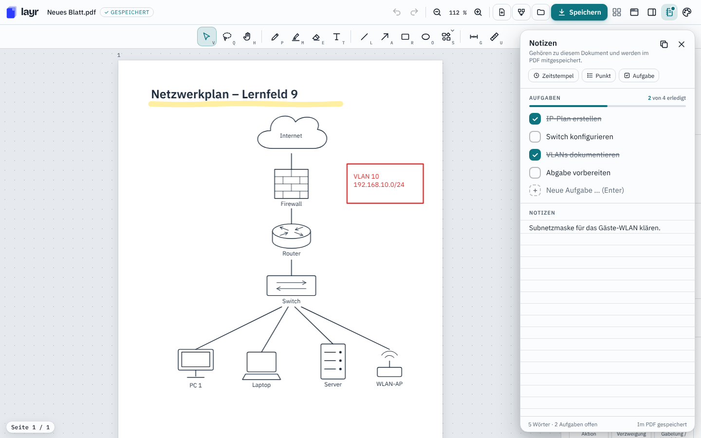

<p align="center"></p>

<h1 align="center">Layr</h1>

<p align="center">Annotate, draw and take notes on PDFs.<br>Desktop app for <b>Windows</b> and <b>Linux</b>.</p>

<p align="center"><a href="https://github.com/fxwfcvwqny-source/Layr/releases/latest"><b>⬇ Download the latest version</b></a></p>



## Features

- **Dictation (offline)** – click the microphone (or press Ctrl+Shift+D, or a shortcut of your choice) and speak into a text box, a table cell or the notes; punctuation included. German, English and 23 more European languages are recognized automatically. Uses NVIDIA's Parakeet v3 model, which runs entirely on your computer – nothing you say is uploaded. The model (about 490 MB) is only downloaded after you agree, the first time you use dictation (desktop app)
- **Tabs** – open several PDFs at once, each in its own tab; switch with a click or Ctrl+Tab, close with × or Ctrl+W. Opening a file that is already open just switches to its tab
- **Write on any PDF** – text boxes with 16 fonts (Arial, Times New Roman, Calibri, Roboto, handwriting …), bold, underline, bullet and numbered lists, automatic capital letters at the start of a sentence (Ctrl+Z undoes it, can be turned off); colour the whole box or just single letters and words. In the saved PDF your text can be selected, copied and searched in any PDF viewer
- **Pen and highlighter with shape recognition** – draw freehand, hold at the end and the stroke snaps into a straight line, circle, rectangle or triangle
- **One select tool** – click to select, drag to move; drag a rectangle on an empty spot to select everything it touches (like on the desktop), then move, scale, recolour, duplicate or delete them together. In the shape tools a click on an existing item moves it, no tool switching needed
- **Images** – insert PNG, JPG, WebP, GIF or SVG with the image tool, Ctrl+V or drag and drop; resize, change opacity, replace
- **Docking connectors** – lines and arrows that start or end on a symbol stick to it and follow when you move it
- **Tables** – drag out a table (toolbar or symbol picker), click a cell to type, Tab from cell to cell; a small bar next to the selected table adds or removes rows and columns, right-click a cell to insert or delete them right there, drag the dividers to resize columns (the width is shown in mm)
- **Org charts** – ready-made templates (line, line-and-staff, divisional, matrix, IT department, project …) plus single building blocks; remove boxes you don't need and their lines go with them
- **Network diagrams** – templates for a small office, a company with DMZ, VLANs, a home network and a school network, all with IP addresses
- **IT calculator** – convert between binary, hexadecimal, decimal and octal with the working shown step by step (two's complement, 8–64 bit), data sizes (GB vs. GiB), transfer times, UPS sizing and battery runtime, power consumption, costs and waste heat; put any result on the page as a table
- **Subnet calculator** – network, broadcast, host range and mask for any IPv4 address, split a network into subnets or plan with VLSM, then put the result on the page as a table
- **Big symbol library** – general shapes, UML, flowcharts (PAP), Nassi-Shneiderman, ER models, 40+ network symbols, topologies and IT-security symbols
- **Notes and to-dos per document** – a notes panel with checkable tasks, stored *inside* the PDF
- **Stays editable** – save over the original file; reopen it in Layr and every annotation can still be moved or removed
- **Fill in PDF forms** – text fields, checkboxes, radio buttons and drop-downs become real input fields; the values are saved into the PDF's own form fields, so every other PDF program sees them
- **Signatures** – draw, type or scan your signature and place it anywhere or into a signature field; Layr can remember it on your device (a visible signature like on paper, not a certificate-based digital signature)
- **Spell checking (German and English)** – misspelled words in text boxes, tables and notes get a red wavy line, right-click for suggestions or to add a word to your dictionary (manage your words under *Settings → Writing & spelling*); works offline with the real Hunspell engine
- **Your own keyboard shortcuts** – change or remove any shortcut under *Settings → Keyboard shortcuts*, e.g. F9 for dictation or a single key for your favourite tool
- **Print (Ctrl+P)** – print the whole document, the current page or a selection like 1-3, 5, with your annotations, form entries and signatures exactly as they will be saved; each page keeps its own size and orientation, and your notes can be added as a last page
- **Search (Ctrl+F)** – find words in the PDF text and in your own annotations, with every match highlighted
- **Pages and documents** – rotate, sort, duplicate and delete pages in a page overview (drag to reorder), add blank, lined, grid or dotted pages, merge several PDFs
- **Rename files** – click the file name at the top left (or press F2) to rename the PDF right where it is
- **Recently opened** – reopen your last files with one click (desktop app; the list stays on your computer and can be turned off)
- **Make it yours** – light and dark themes, accent colours, desk and sheet colours, toolbar styles, notification styles, animations on or off

**Deutsch & English** – choose the language in the Windows installer or on first start, and switch any time under *Settings → Customize design*.

## Installation

Download the file for your system from the [latest release](https://github.com/fxwfcvwqny-source/Layr/releases/latest).

| System | File | How to install |
|---|---|---|
| Windows 10/11 | `Layr-Setup-<version>.exe` | Run it, pick Deutsch or English and follow the setup. No admin rights needed. |
| Ubuntu / Debian | `Layr-<version>-amd64.deb` | Double-click, or `sudo apt install ./Layr-<version>-amd64.deb` |
| Any Linux | `Layr-<version>-x86_64.AppImage` | Make it executable (`chmod +x`) and double-click. Nothing gets installed. |

**Windows SmartScreen:** the installer is not code-signed, so Windows may show *"Windows protected your PC"* the first time. Click **More info → Run anyway**.

**Updates** (*Settings* ⚙ at the top right → *Layr & updates*): Layr checks this page for a newer version and installs it by itself: the new installer is downloaded in the background and installed when you restart or quit Layr. Before that, Layr checks the release's update description against a digital signature (Ed25519, the public key is built into Layr) and the file against the SHA-512 checksum in that signed description. If anything doesn't match, nothing is installed and Layr only offers the download page. On Ubuntu with the `.deb` package, Ubuntu asks for your password to install it; if no password window appears, Layr can open a terminal for the installation instead. Both can be turned off under *Settings → Layr & updates*.

## Privacy

- Your PDFs, notes and settings stay on your computer. Layr has no account, no telemetry and no tracking.
- Layr only goes online for updates: it asks the public GitHub API for the latest version number and downloads new versions from this repository's releases. Both can be turned off.
- Spell checking runs completely offline. Electron's built-in spell checker, which would download dictionaries from a Google server, is switched off. Only if you click *Download German dictionary* does Layr fetch that one file from the public npm registry (see [THIRD_PARTY_NOTICES.md](THIRD_PARTY_NOTICES.md)).
- Remembered signatures and your personal dictionary stay on your computer.
- Crash reports are only written locally to Layr's own settings folder and are never uploaded.
- The "Recently opened" list only stores file paths in Layr's settings folder on your computer. You can clear it or turn it off under *Settings → Layr & updates*.

## Security

- PDFs are rendered with an up-to-date [PDF.js](https://github.com/mozilla/pdf.js) without any `eval`, and the desktop app runs under a strict Content Security Policy: no code from PDFs, no external scripts, no connections from the page to other servers.
- The page has no access to Node.js or your files. It can only ask the main process for a small set of actions (open, save, rename …), and the main process only answers its own page. Saving only writes to the open file, to a place you picked in the system's save dialog or – when a new sheet is saved automatically – to a new file in your last-used folder that never replaces an existing one.
- Links and navigation are locked: only https links to this repository are opened in your browser.
- Files are written through a temporary file that is created exclusively (no symlink tricks) and keeps the original file permissions; renaming never overwrites another file.
- Data stored inside PDFs by Layr (annotations, form values) is checked and limited before it is used.
- Electron [fuses](https://www.electronjs.org/docs/latest/tutorial/fuses) are set: Layr can't be started as a plain Node.js interpreter, ignores `NODE_OPTIONS` and debugging switches and only runs its own integrity-checked `app.asar`.

Found a security problem? Please open an issue without details and ask for a private contact.

## Building from source

Requires [Node.js](https://nodejs.org/) 22 or newer.

```bash
npm install
npx electron-builder --win     # Windows installer (on Linux this needs Wine)
npx electron-builder --linux   # AppImage
```

Official downloads are built by GitHub Actions directly from this repository ([`.github/workflows/release.yml`](.github/workflows/release.yml)), so every installer matches the code you see here. Before uploading, the workflow starts the built app and runs a short smoke test ([`build/smoke-test.mjs`](build/smoke-test.mjs)); afterwards it signs the update descriptions ([`build/sign-update.mjs`](build/sign-update.mjs)).

The app itself is plain HTML/JavaScript in [`app/web/index.html`](app/web/index.html); [`app/main.js`](app/main.js) is the Electron main process.

## License

Copyright © 2026 Layr. All rights reserved.
Bundled third-party components keep their own licenses, see [THIRD_PARTY_NOTICES.md](THIRD_PARTY_NOTICES.md).
